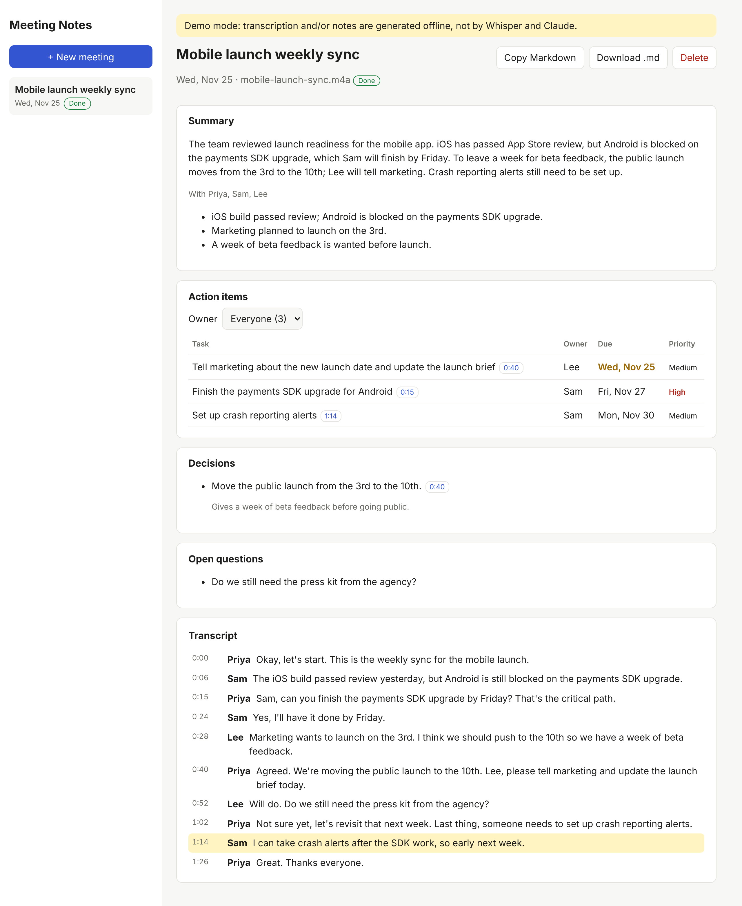
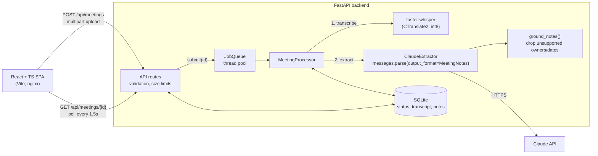
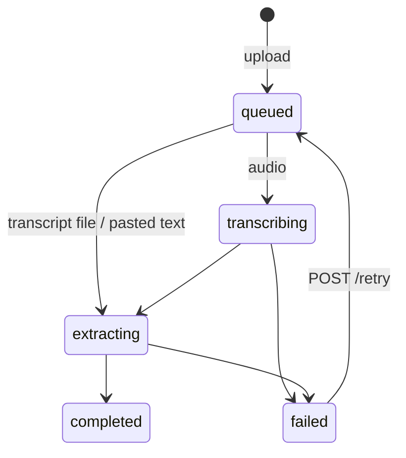
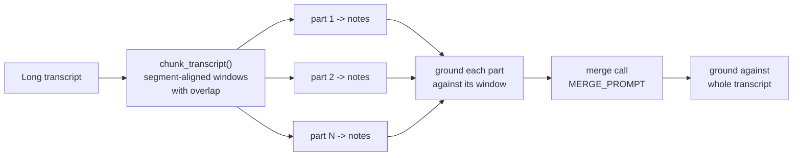

# AI Meeting Notes

Upload a meeting recording and get notes people can act on: a summary, the decisions
that were actually made, and action items with owners and real due dates. Audio is
transcribed locally with [faster-whisper](https://github.com/SYSTRAN/faster-whisper);
the notes come from the Claude API using **structured outputs**, so the response is
constrained to a JSON schema and parsed straight into a validated Pydantic model.



**Features**

- Upload audio/video (mp3, m4a, wav, webm, mp4, …) or a transcript (`.vtt`, `.srt`, `.txt`), or paste text.
- Background processing with live progress (queued → transcribing → writing notes → done).
- Action items with owner, ISO due date, and priority. "By Friday" becomes `2026-11-27`
  because the meeting date is part of the prompt.
- Every decision and action item links back to the moment in the transcript it came from.
- **Grounding check:** owners nobody mentioned, due dates before the meeting, and
  timestamps past the end of the recording are cleared instead of trusted.
- Check action items off, fix an owner or date the model got wrong, add ones it missed;
  filter by owner or hide done items; copy or download the notes as Markdown.
- Long meetings (workshops, offsites) are summarised in overlapping parts and merged,
  instead of being truncated or refused.
- Failed jobs keep their audio and transcript and can be retried; work in flight when the
  server stops is picked up again on restart.
- Offline demo mode (no API key, no model download) for trying the UI.

## Architecture





| Path | What it does |
|---|---|
| `backend/app/api/routes.py` | Upload (streamed to disk with a size cap), paste, list, detail, retry, delete, Markdown export, action item editing |
| `backend/app/services/transcription.py` | `Transcriber` protocol; faster-whisper implementation, loaded lazily and shared across threads |
| `backend/app/services/transcript_parser.py` | WebVTT / SRT / `Speaker: text` parsing, and the `[m:ss] Speaker: text` rendering sent to Claude |
| `backend/app/services/extraction.py` | Prompts, Claude call, map-reduce for long meetings, error mapping, grounding check, offline demo extractor |
| `backend/app/services/chunking.py` | Splits long transcripts into overlapping, segment-aligned windows |
| `backend/app/services/pipeline.py` | Per-meeting state machine and the bounded worker pool |
| `backend/app/schemas.py` | `MeetingNotes` and friends: the API contract *and* the JSON schema sent to Claude |
| `frontend/src` | Upload panel, polling hook, notes view, action-item table, transcript view |

## Running it

### Docker (everything)

```bash
cp backend/.env.example .env        # then set ANTHROPIC_API_KEY
docker compose up --build
open http://localhost:8080
```

The first transcription downloads the Whisper model (`base`, ~150 MB) into the
`whisper-models` volume. Set `AMN_WHISPER_MODEL=small` or `large-v3` for better accuracy
at the cost of speed.

No API key? `AMN_EXTRACTOR=fake AMN_TRANSCRIBER=fake docker compose up` runs the full UI
offline with a built-in demo meeting.

### Local development

```bash
# backend (Python 3.12+, uv)
cd backend
uv sync --extra whisper
ANTHROPIC_API_KEY=sk-ant-... uv run uvicorn app.main:create_app --factory --reload

# frontend (Node 22) - proxies /api to :8000
cd frontend
npm install
npm run dev                          # http://localhost:5173
```

### API

```bash
curl -F file=@standup.m4a -F meeting_date=2026-11-25 localhost:8000/api/meetings
# {"id":"55ca…","status":"queued",…}
curl localhost:8000/api/meetings/55ca…            # poll until "completed"
curl localhost:8000/api/meetings/55ca…/markdown   # notes as Markdown
```

Action items can be corrected after extraction:

```bash
curl -X PATCH -H 'content-type: application/json' -d '{"done": true}' \
  localhost:8000/api/meetings/55ca…/action-items/3f9a…      # check off
curl -X PATCH -H 'content-type: application/json' -d '{"owner": "Priya", "due_date": null}' \
  localhost:8000/api/meetings/55ca…/action-items/3f9a…      # fix owner, clear date
curl -X POST -H 'content-type: application/json' -d '{"task": "Book the retro"}' \
  localhost:8000/api/meetings/55ca…/action-items            # add one the model missed
```

Interactive docs at `http://localhost:8000/docs`.

### Configuration

All settings are environment variables (see [`backend/.env.example`](backend/.env.example)).

| Variable | Default | |
|---|---|---|
| `ANTHROPIC_API_KEY` | | Required when `AMN_EXTRACTOR=claude` |
| `AMN_CLAUDE_MODEL` | `claude-opus-5-5` | |
| `AMN_CLAUDE_EFFORT` | `medium` | `low` … `max`; higher is slower and more careful |
| `AMN_WHISPER_MODEL` | `base` | Any faster-whisper model name |
| `AMN_WHISPER_DEVICE` / `AMN_WHISPER_COMPUTE_TYPE` | `auto` / `int8` | `cuda` + `float16` on a GPU |
| `AMN_MAX_UPLOAD_MB` | `200` | |
| `AMN_CHUNK_CHARS` | `200000` | Longer transcripts are summarised in parts and merged |
| `AMN_CHUNK_OVERLAP_SEGMENTS` / `AMN_CHUNK_CONCURRENCY` | `3` / `4` | Overlap between parts; parts sent in parallel |
| `AMN_MAX_TRANSCRIPT_CHARS` | `2000000` | Hard cap; longer transcripts are refused, never truncated |
| `AMN_WORKER_CONCURRENCY` | `2` | Meetings processed in parallel |
| `AMN_DELETE_AUDIO_AFTER_PROCESSING` | `true` | Audio is kept only until notes succeed |
| `AMN_EXTRACTOR` / `AMN_TRANSCRIBER` | `claude` / `whisper` | `fake` for offline demo mode |

## Design decisions

- **Structured outputs over "please reply in JSON".** `MeetingNotes` is a Pydantic model
  with `extra="forbid"` and field descriptions; the SDK turns it into the JSON schema the
  API decodes against, and returns a parsed instance. There is no regex extraction or
  JSON repair step, and the same model is the HTTP response schema, so the contract is
  defined once.
- **Validate, then ground.** A schema guarantees shape, not truth. After parsing,
  `ground_notes()` checks the content against the transcript: an owner must appear as a
  whole word in the meeting, a due date can't precede it, a timestamp can't be past the
  end. Unsupported values are cleared (and logged), because a blank owner is less harmful
  than a wrong one.
- **Relative dates are resolved by the model, with the anchor in the prompt.** The prompt
  states the meeting date and weekday, and defines "next week" as the following Monday.
  The user sets the meeting date on upload; it defaults to today.
- **Timestamps in the transcript.** The model sees `[m:ss] Speaker: text`, so it can cite
  where each decision happened; the UI uses that to jump to and highlight the line.
- **Long meetings: map-reduce, never truncate.** A transcript over `AMN_CHUNK_CHARS`
  (~50k tokens) is split on segment boundaries into windows that overlap by a few
  lines, so an item assigned across a boundary is seen whole by one window. Each window
  is summarised concurrently with the same schema, grounded against *its own* text (so a
  part cannot invent an owner that the merge then "confirms"), and a second call merges
  the parts: de-duplicating overlap, keeping only the final version of a reversed
  decision, and dropping questions answered later. The merged notes are grounded again
  against the whole meeting. Only past a hard cap (`AMN_MAX_TRANSCRIPT_CHARS`, ~40 hours
  of speech) is a transcript refused, with a clear error instead of silently dropping
  its end, which is usually where the action items are.


- **Failure handling.** API errors are mapped to user-facing messages and a `retryable`
  flag (rate limits, 5xx, network); the SDK also retries transient errors itself. Refusals
  and `max_tokens` cut-offs are surfaced, never parsed. Server-side refusal fallbacks are
  enabled (`fallbacks="default"`). Unexpected exceptions are logged with a stack trace but
  shown to users as a generic message.
- **Simple, restart-safe jobs.** Whisper and the Claude call are blocking, so a bounded
  `ThreadPoolExecutor` is enough at this scale and needs no broker. All state is in the
  database, not the queue: on startup anything left `queued`/`transcribing`/`extracting`
  is re-queued. Swapping in Celery/RQ later only touches `JobQueue`.
- **People get the last word on action items.** The schema sent to Claude (`ActionItem`)
  has no `id`/`done` fields, so the model can't fill them in; stored notes use a subclass
  (`TrackedActionItem`) that adds a stable id, `done`, and an `edited` flag set when a
  person changes extracted content (checking an item off doesn't count). Edits are an
  atomic read-modify-write of the notes JSON under a lock, so concurrent clicks can't
  lose updates (there's a test that fails without the lock). In the UI, checking off is
  optimistic and rolls back if the server refuses.
- **Uploads are streamed** to disk in 1 MB chunks with the size limit enforced while
  reading; filenames are reduced to their basename and stored under a random UUID.
- **Everything external sits behind a protocol** (`Transcriber`, `NotesExtractor`), so
  tests use in-process fakes and never load a model or call the API.

## Tests

| Suite | Count | What it covers |
|---|---|---|
| Backend `pytest` | 130 (+2 opt-in) | API end to end through the real queue and SQLite, pipeline failure paths, restart recovery, concurrency, Claude request shape and error mapping (mocked client), long-meeting chunking and map-reduce (part grounding, merge order, failure of one part), action item editing (validation, 404/409, lost-update race), grounding rules, transcript parsing, Markdown export, config |
| Real Whisper (CI) | 2 | faster-whisper can decode audio with the pinned PyAV; `tiny.en` transcribes speech synthesised by `espeak-ng`. Run with `uv sync --extra whisper && AMN_RUN_WHISPER=1 uv run pytest -m whisper` |
| Frontend `vitest` | 63 | API client, upload validation and submission, polling with fake timers, retry/delete, owner filter, transcript jump, routing, action item check-off (optimistic + rollback), edit/add/remove |

```bash
cd backend && uv run pytest && uv run ruff check . && uv run mypy
cd frontend && npm test && npm run lint && npm run typecheck
```

CI runs all of the above plus a `docker compose build` on every push.
